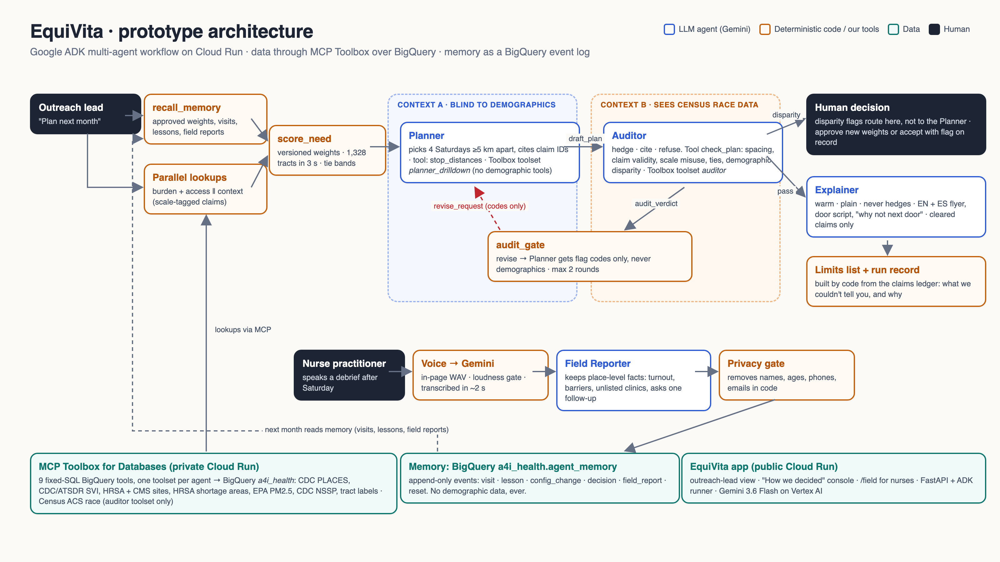

# EquiVita

**Where the mobile clinic parks next month, and why.**

One county, one van with a nurse practitioner, four Saturdays a month. EquiVita is a multi-agent system
that helps a county outreach lead decide where the van goes, explains each choice to the neighborhoods it
serves, audits who the plan reaches, and learns from what the nurse reports back. It plans **places, not
people**, and every number it shows carries the scale it is true at.

Agents for Impact 2026 · Challenge 5 (Dynamic Public Health Equity) · Track: **Siting**, with Accountability
and Explanation built in · County: **Cook County, IL** (1,328 census tracts)

| | Link |
|---|---|
| Live app (outreach-lead view) | https://equivita-375283687966.us-central1.run.app |
| How we decided (agent trace, audit rounds, memory, claims ledger) | https://equivita-375283687966.us-central1.run.app/console |
| Field report (nurse voice debrief) | https://equivita-375283687966.us-central1.run.app/field |

## What it produces: the Clinic Plan

1. **Where the van goes, and why.** Four dated Saturdays, each a named tract ("Chicago (60633) · tract 8388")
   with its reason in plain numbers, the nearest free clinic for follow-up, and *why here and not next door*.
2. **Who this plan lands on.** An equity audit against race and ethnicity data the planner never sees,
   reported even when it is uncomfortable.
3. **What we couldn't tell you.** A limits list built by code from the claims ledger, never free text.
4. **The thing you hand to the neighborhood.** A flyer and door script in English and Spanish, plus an
   outreach plan per stop: channels chosen by code from the data, ordered by an agent using real nearby places.

## What we found

- **The obvious answer fails.** Ranking by "most need × farthest from care" sent the van to insured suburbs:
  in Cook County, distance to a free clinic correlates **−0.65** with households that have no car.
- **The audit changed the plan.** Distance-first → need-first (human-approved), top 30 tracts:

  | | Distance-first | Need-first |
  |---|---|---|
  | Median adults uninsured | 8.6% (county median 10.5%) | **18.0%** |
  | Homes without a car | 7.0% | **49.5%** |
  | In a federal shortage area | 0 of 30 | **30 of 30** |

- **One finding stays open, on purpose.** Need-first stops are mostly in Black neighborhoods while the
  county's most-uninsured tenth of tracts is 82% Hispanic. We do not score on limited English (too close to
  an ethnicity proxy); it chooses outreach channels instead. The audit flags the gap to a person.
- **Air quality can't rank neighborhoods.** PM2.5 varies 1.06× across tracts (it's a 12 km model grid);
  uninsurance varies 4.75×, no-vehicle 16×. We use air for county context only.

## How it works



A Google ADK workflow (`agent/clinic_plan/agent.py`):

```
recall_memory → [lookup_tracts ‖ lookup_context] → score_need
  → loop (max 2): planner → auditor → audit_gate
  → finalize_plan → plan_channels → outreach_reasoner → outreach_check → explainer → limits_and_persist
```

| Part | Kind | Role |
|---|---|---|
| `planner` | LLM agent, **blind** | Picks 4 Saturdays ≥ 5 km apart from `score_need` candidates; every reason cites claim IDs. Its MCP toolset has no demographic tool |
| `auditor` | LLM agent, separate context | Hedges, cites, refuses. Runs `check_plan` (spacing, claim validity, scale misuse, tie bands, demographic disparity) with Census race data |
| `audit_gate` | code | Sends the planner flag codes only, never demographics; routes disparity to a human |
| `explainer` | LLM agent | Warm, plain, never hedges. EN + ES flyer and door script from cleared claims only |
| `outreach_reasoner` | LLM agent | Orders code-picked outreach channels per stop, citing nearby places; `outreach_check` drops anything invented |
| `field_reporter` | LLM agent | Turns a nurse's spoken debrief into place-level facts; a code privacy gate removes names, ages, phones |
| `score_need`, `stop_distances`, `check_plan` | our tools | Deterministic scoring with versioned weights, distance checks, audit checks |

**The four questions judges ask, answered**

| Question | Answer |
|---|---|
| Delete any one agent: does it get worse? | No auditor: the suburban plan ships unchallenged. No field reporter: the van returns to a tract with an unlisted free clinic. No explainer: nothing for residents |
| A `session.state` key written by one agent, read by another | Planner writes `draft_plan` → auditor reads it, writes `audit_verdict` → gate writes `revise_request` → planner reads it |
| Two agents whose instructions conflict | Auditor: hedge, cite, refuse. Explainer: warm, plain, never hedge |
| Where the system rejected its own first answer | Audit rounds reject drafts (e.g. two stops 3.9 km apart) and the planner revises; and the human-approved switch from distance-first to need-first |

**Memory** is an append-only event log in BigQuery (`a4i_health.agent_memory`): visits, lessons, human
decisions, config changes and field reports. The planner reads it every run. It never contains demographic data.

**Performance** (Cloud Run): a full plan in ~65 s; data for 1,328 tracts through MCP Toolbox and scored in
3 s; voice transcribed by Gemini in ~2 s.

## Stack

Google ADK 2.7 (Python) · Gemini 3.6 Flash on Vertex AI · MCP Toolbox for Databases 1.17 (BigQuery, one
toolset per agent) · BigQuery · Cloud Run (public app + private Toolbox) · Secret Manager · FastAPI.

## Data

| Source | Used for | Scale | Kind |
|---|---|---|---|
| CDC PLACES 2025 | Uninsured, diabetes, blood pressure, COPD | Tract | Modeled |
| CDC/ATSDR SVI 2022 | No vehicle, limited English, no internet, age | Tract | Survey estimate |
| HRSA health centers + CMS facilities | Free / sliding-scale clinics, hours | Facility point | Federal sites only |
| HRSA shortage areas | Federal shortage score | Tract (in Cook) | Designation |
| EPA/CDC daily PM2.5 | County air context (never ranks) | 12 km grid | Modeled |
| CDC NSSP ED visits | Regional respiratory trend (never ranks) | 4-county region | Measured |
| Census ACS 2020 (BigQuery public) | **Auditor only:** race and ethnicity | Tract | Survey estimate |
| Census ZIP boundaries (BigQuery public) | Plain-English tract names | ZIP | Boundaries |
| Overture Maps places (BigQuery public, CDLA-Permissive-2.0) | Named places for outreach | Point | Map data |
| Nurse field reports (ours) | Barriers, unlisted clinics, turnout | Observation | One day's notes |

Left out on purpose: race as a scoring input, Access Across America transit data (CC BY-NC), Chicago
community-area names (no clear license), NPPES and anything patient-level.

## Limits

Distances are straight-line, not travel time, and only to federally recognized sites (upper bounds).
Prevalence is modeled, not counted. Confidence intervals aren't loaded, so near-tied tracts are reported as
comparable rather than ranked. Disease data is regional. Outreach covers English and Spanish only.

## Run it locally

```bash
python3 -m venv .venv && .venv/bin/pip3 install -r requirements.txt
cp agent/clinic_plan/.env.example agent/clinic_plan/.env     # project, location=global, model, dev memory table
export GOOGLE_APPLICATION_CREDENTIALS=$(ls ~/.config/gcloud/legacy_credentials/*/adc.json)   # or ADC login
# start MCP Toolbox (see toolbox/README.md), then:
.venv/bin/python -m uvicorn dashboard.app:app --port 8090    # http://127.0.0.1:8090
```

Data load: `bash scripts/load.sh 17031` (or the notebook in `notebooks/`). Deployment: `Dockerfile`
and the commands in `docs/outreach-kit-spec.md`.

## Repository

```
agent/clinic_plan/   ADK agents, workflow steps, scoring, memory, field reporter, outreach
dashboard/           FastAPI app: outreach-lead view, console, field page
toolbox/             MCP Toolbox config (tools.yaml), smoke test
scripts/             data load, profiling, score comparison, outreach demo
sql/                 early need-score exploration
docs/                architecture, pitch script, console guide, specs, notes, original challenge brief
```

Original challenge brief: [docs/CHALLENGE.md](docs/CHALLENGE.md). Licensed under the terms in `LICENSE` and `NOTICE`.
